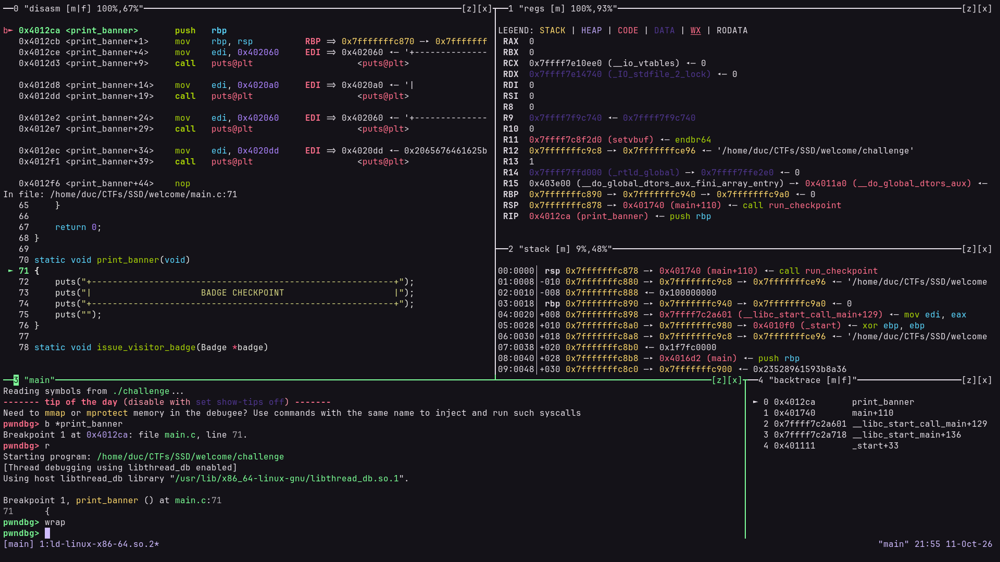
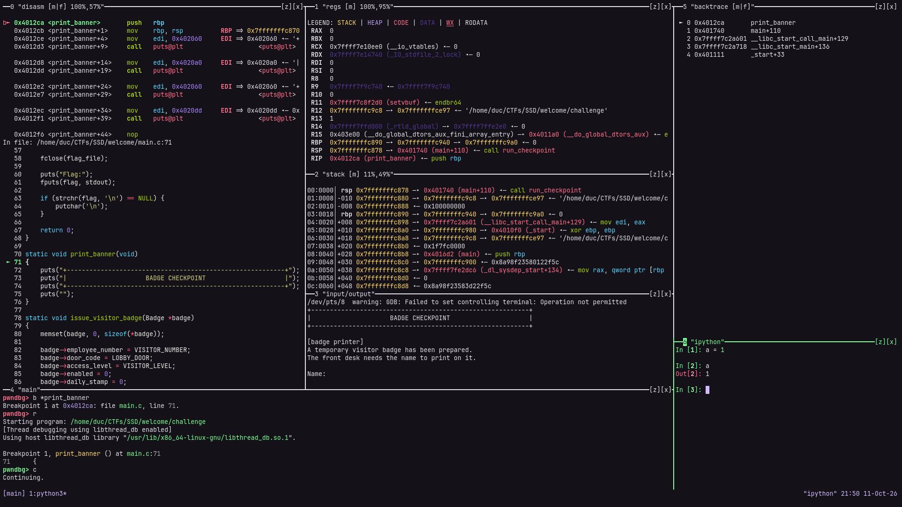
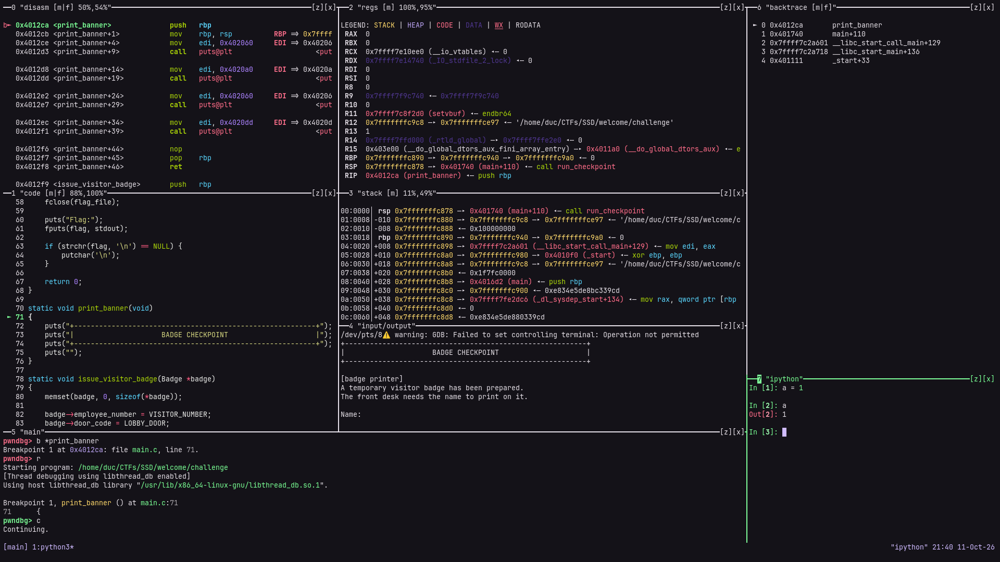

# tuimux

A tmux-based TUI setup for [pwndbg](https://github.com/pwndbg/pwndbg). It splits your tmux window into dedicated panes and streams each pwndbg context section into its pane. Each pane is a small scrollable TUI viewer with line wrapping, mouse support, copy-on-select and text following.



## Features

- **Automatic layout.** Panes are created on the first prompt, and only when GDB is running inside tmux.
- **A real viewer in every pane.** Scroll vertically and horizontally, toggle line wrap, and select text with the mouse. Colors (SGR) are preserved.
- **Follow text.** On update, a pane can scroll so the first line matching a regex (like pwndbg's `►` line marker) stays centered.
- **Flicker-free.** Output is redrawn in atomic, diffed updates and coalesced in short bursts, so fast `context` refreshes stay smooth.
- **Clipboard integration.** Dragging copies via OSC 52 and into the tmux paste buffer.
- **Pane navigation.** Alt+h/j/k/l, Alt+Arrows to navigate between panes, and Alt+z to zoom work without the tmux prefix.
- **Clean teardown.** Panes, FIFOs and tmux options are removed when GDB exits.
- **Customizable.** A layout is just a Python function, and the example configs include alternate layouts.

## Requirements

- [pwndbg](https://pwndbg.re/stable/setup) (~/.gdbinit setup or pwndbg-gdb installer setup), started inside a tmux session
- [tmux](https://github.com/tmux/tmux)

## Installation

```sh
git clone https://github.com/duclm278/tuimux
echo "source $PWD/tuimux/gdbinit.py" >> ~/.gdbinit
```

Your `~/.gdbinit` should look like this. Make sure tuimux is sourced **after** pwndbg loaded:

```gdb
# Only needed for ~/.gdbinit setup
source /path/to/pwndbg/gdbinit.py

set context-clear-screen on
set follow-fork-mode parent

source /path/to/tuimux/gdbinit.py

# Recommended if sections have separate panes, see "Follow text"
# set context-disasm-lines 32
# set context-code-lines 32
set context-stack-lines 128
set context-backtrace-lines 128
```

Start `tmux`. Run `gdb ./binary` or `pwngdb ./binary` depending on your setup. The panes will appear when the first prompt is shown.

> **Note:** if pwndbg isn't importable, tuimux exits silently and does nothing. If no layout appears, check that pwndbg is sourced first.

## Usage

### Pane viewer keys

Click or focus a pane and use:

| Key | Action |
| --- | --- |
| `h` `j` `k` `l` or Arrows | Scroll by 10 columns or rows |
| `H` `J` `K` `L` or Shift+Arrows | Scroll by 20 columns or rows |
| `PgUp` / `PgDn` | Scroll by one page |
| `0` / `Home`, `$` / `End` | Jump to line start / end |
| `g` / `G` | Jump to top / bottom |
| `w` | Toggle line wrap |
| `f` | Toggle follow (panes with follow only) |
| `m` | Toggle mouse capture (to forward mouse events to tmux) |

**Mouse:** the scroll wheel or a two-finger swipe scrolls vertically (hold Shift for horizontal). Dragging selects text and copies it on release.

Each pane's title shows its state and edge position, for example `disasm [w|m|f] 64%,100%`. `[w]`, `[m]` and `[f]` mean wrap, mouse capture and follow are on. The percentages show how much of the content's bottom and right edge is visible, where 100% means fully visible.

### Follow text

A pane created with `follow="REGEX"` re-centers the first matching line every time new output arrives, vertically and horizontally. The default layout follows `►` in `disasm` and `backtrace`, so the current instruction and frame stay in the middle as you step.

- Press `f` to pause or resume. Following also overrides manual scrolling on the next update, so pause it when you want to look around.
- Matching is `re.search` per visual row, colors ignored. Examples: `►`, `^\s*►`, `(?i)error`.

**Tip: set `context-<section>-lines` to a high number.** The viewer scrolls, so there is no need to keep context short. With a large window of lines, you can scroll freely around the current instruction, stack or call chain, while follow keeps `►` in the middle:

```gdb
set context-disasm-lines 32
set context-code-lines 32
set context-stack-lines 128
set context-backtrace-lines 128
```

### tmux bindings

tuimux adds these root-table bindings (no prefix needed):

| Key | Action |
| --- | --- |
| `Alt+h/j/k/l` or `Alt+Arrows` | Move between panes |
| `Alt+z` | Zoom or unzoom the current pane |

It also turns on `mouse` and `pane-border-status top` for tmux. The pane border status is switched off again on exit.

### GDB command

- In GDB, use the command `wrap` to toggle wrapping in all panes at once.

## Layouts

The layout lives in a `design()` function. Redefining it in your ~/.gdbinit **after** sourcing `tuimux/gdbinit.py` replaces the default. Four examples are included.

| File | Description |
| --- | --- |
| `simple.gdbinit` | Default layout |
| `simple-code.gdbinit` | Default layout plus a separate `code` pane (source view) |
| `splitmind.gdbinit` | A [splitmind](https://github.com/jerdna-regeiz/splitmind)-style layout with extra input/output and ipython panes |
| `splitmind-code.gdbinit` | The splitmind layout plus a separate `code` pane |

The `simple` (default) layout looks like this:

```txt
┌───────────────────────┬───────────────────────┐
│ disasm                │ regs                  │
│                       ├───────────────────────┤
│                       │ stack                 │
├───────────────────────┴───────────┬───────────┤
│ main (gdb)                        │ backtrace │
└───────────────────────────────────┴───────────┘
```

The `simple-code` layout looks like this:

```txt
┌───────────────────────┬───────────────────────┐
│ disasm                │ regs                  │
├───────────────────────┤                       │
│ code                  ├───────────────────────┤
│                       │ stack                 │
├───────────────────────┴───────────┬───────────┤
│ main (gdb)                        │ backtrace │
└───────────────────────────────────┴───────────┘
```

The `splitmind` layout looks like this:

```txt
┌───────────┬───────────────────────┬───────────┐
│ disasm    │ regs                  │ backtrace │
│           ├───────────────────────┤           │
│           │ stack                 │           │
│           ├───────────────────────┤           │
│           │ input/output          ├───────────┤
├───────────┴───────────────────────┤ ipython   │
│ main (gdb)                        │           │
└───────────────────────────────────┴───────────┘
```

Demo:



The `splitmind-code` layout looks like this:

```txt
┌───────────┬───────────────────────┬───────────┐
│ disasm    │ regs                  │ backtrace │
│           │                       │           │
├───────────┤───────────────────────┤           │
│ code      │ stack                 │           │
│           ├───────────────────────┤           │
│           │ input/output          ├───────────┤
├───────────┴───────────────────────┤ ipython   │
│ main (gdb)                        │           │
└───────────────────────────────────┴───────────┘
```

Demo:



The `code` layouts give source its own pane (also with follow), so disasm and source are visible side by side vertically. They are meant to be used with the high `context-*-lines` values above. The input/output pane prints its tty. In GDB shell, run `tty /dev/pts/<num>` to redirect the binary's input/output to that pane.

### Writing your own

Inside `design()` you have two helpers:

```python
view(target, direction, size, title, wrap=True, mouse=True, follow=None)  # a viewer pane fed by a FIFO
tmux(target, direction, size, title, cmd="cat -")                         # any command in a plain pane
```

Both split the pane `target` and return a pane object with `.id` and `.path`. The directions are `-hb` (left), `-v` (down), `-vb` (up) and `-h` (right), and `size` is a tmux `-l` value such as `"30%"` or `"25"`. `follow` is a regex to keep centered (e.g. `"►"`). Then map pwndbg context sections to panes:

```python
def design():
    ma_id = os.environ["TMUX_PANE"]
    call(f'tmux select-pane -T "main" -t {ma_id}')

    L, D, U, R = "-hb", "-v", "-vb", "-h"
    di = view(ma_id, U, "60%", "disasm", follow="►")
    co = view(di.id, D, "55%", "code", follow="►")
    st = view(di.id, R, "40%", "stack")

    for section, pane in {"disasm": di, "code": co, "stack": st}.items():
        contextoutput(section, pane.path, clearing=True, banner="none")
```

The above example creates a disasm pane above the main pane, a code pane below disasm, and a stack pane to the right of disasm. The `contextoutput()` calls redirect the context sections into the matching pane paths.

Sections can share the same pane (like "disasm" and "code" both using one pane in the default layout). You can use `tmux()` to create panes that don't need the features of the FIFO viewer (see `splitmind.gdbinit` for an example).

The sections pwndbg offers include `regs`, `legend`, `disasm`, `code`, `stack`, `backtrace`, `expressions` and `ghidra`. Any section you don't map stays in the main GDB pane.

## How it works

1. `gdbinit.py` waits for the first GDB prompt, then runs `init()`. User can override anything functions like `design()` and `init()` to customize the logic.
2. For each viewer pane it creates a named FIFO at `/tmp/view-<pid>-<title>.fifo` and splits a tmux pane running `fifo.py <fifo> <title>`.
3. pwndbg's `contextoutput` redirects each context section into the matching FIFO.
4. `fifo.py` reads the FIFO, treats a clear-screen sequence as the start of a new frame, and redraws the pane. It sanitizes escape sequences, keeps colors, handles wide Unicode characters, and supports selection, scrolling and follow.
5. On exit, the `atexit` handlers kill the panes, delete the FIFOs and restore tmux settings.

`fifo.py` can also be used on its own:

```sh
mkfifo /tmp/demo.fifo
python3 fifo.py /tmp/demo.fifo demo --no-wrap --follow '►'

# in another terminal
echo hello > /tmp/demo.fifo
```

## Files

```
gdbinit.py              GDB entry point to create panes and wire up pwndbg
fifo.py                 Standalone FIFO viewer used in each pane
simple.gdbinit          Example config, default layout
simple-code.gdbinit     Example config, default layout with code pane
splitmind.gdbinit       Example config, splitmind-style layout
splitmind-code.gdbinit  Example config, splitmind-style layout with code pane
```

## Troubleshooting

- **Nothing happens.** GDB must be started inside tmux (`$TMUX` and `$TMUX_PANE` must be set), and pwndbg must be loaded before tuimux.
- **Can't select text with the terminal's native selection.** Press `m` in the pane to release the mouse capture.
- **Can't scroll, the view keeps jumping back.** Follow is on. Press `f` in the pane to pause it.
- **Stale FIFOs after a crash.** Delete them with `rm /tmp/view-*.fifo`.
- **warning: GDB: Failed to set controlling terminal: Operation not permitted.** Just ignore it. It also happens with [splitmind](https://github.com/jerdna-regeiz/splitmind).

## Acknowledgements

- [kittydbg](https://github.com/k4lizen/kittydbg): A gdbinit configuration that uses kitty tiling to take better advantage of the empty space present in the pwndbg output.
- [pwnmux](https://github.com/joaogodinho/pwnmux): A gdbinit configuration that uses pwndbg and tmux to create multiple panes for different contexts, making debugging a more enjoyable experience.
- [splitmind](https://github.com/jerdna-regeiz/splitmind): A python module that helps to setup a layout of splits to organize presented information.
