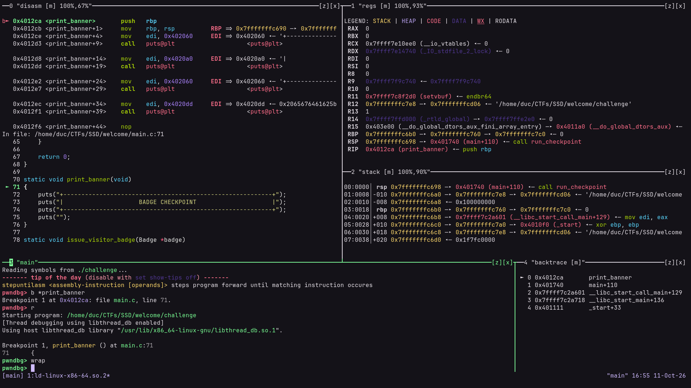
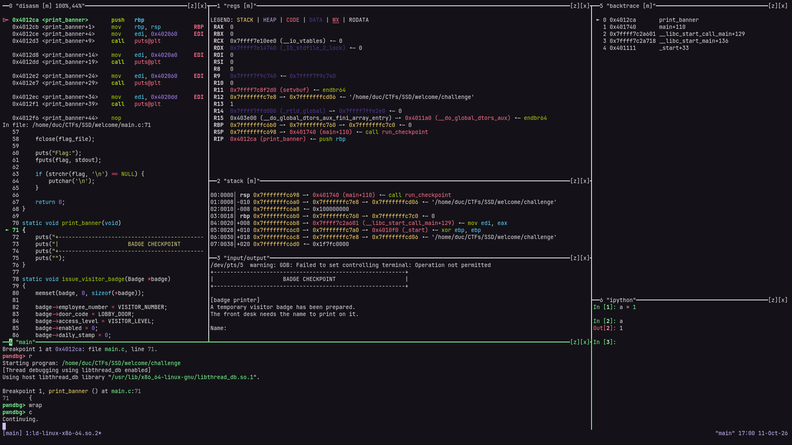

# tuimux

A tmux-based TUI setup for [pwndbg](https://github.com/pwndbg/pwndbg). It splits your tmux window into dedicated panes and streams each pwndbg context section into its pane. Each pane is a small scrollable TUI viewer with line wrapping, mouse support and copy-on-select.



## Features

- **Automatic layout.** Panes are created on the first prompt, and only when GDB is running inside tmux.
- **A real viewer in every pane.** Scroll vertically and horizontally, toggle line wrap, and select text with the mouse. Colors (SGR) are preserved.
- **Flicker-free.** Output is redrawn in atomic, diffed updates and coalesced in short bursts, so fast `context` refreshes stay smooth.
- **Clipboard integration.** Dragging copies via OSC 52 and into the tmux paste buffer.
- **Pane navigation.** Alt+h/j/k/l, Alt+Arrows to navigate between panes, and Alt+z to zoom work without the tmux prefix.
- **Clean teardown.** Panes, FIFOs and tmux options are removed when GDB exits.
- **Customizable.** A layout is just a Python function, and the example configs include alternate layouts.

## Requirements

- [pwndbg](https://pwndbg.re/stable/setup) (~/.gdbinit setup or pwndbg-gdb installer setup), started inside a tmux session
- [tmux](https://github.com/tmux/tmux)

## Installation

```sh
git clone https://github.com/duclm278/tuimux
echo "source $PWD/tuimux/gdbinit.py" >> ~/.gdbinit
```

Your `~/.gdbinit` should look like this. Make sure tuimux is sourced **after** pwndbg loaded:

```gdb
# Only needed for ~/.gdbinit setup
source /path/to/pwndbg/gdbinit.py      

set context-clear-screen on
set follow-fork-mode parent

source /path/to/tuimux/gdbinit.py
```

Start `tmux`. Run `gdb ./binary` or `pwngdb ./binary` depending on your setup. The panes will appear when the first prompt is shown.

> **Note:** if pwndbg isn't importable, tuimux exits silently and does nothing. If no layout appears, check that pwndbg is sourced first.

## Usage

### Pane viewer keys

Click or focus a pane and use:

| Key | Action |
| --- | --- |
| `h` `j` `k` `l` or Arrows | Scroll by 10 columns or rows |
| `H` `J` `K` `L` or Shift+Arrows | Scroll by 20 columns or rows |
| `PgUp` / `PgDn` | Scroll by one page |
| `0` / `Home`, `$` / `End` | Jump to line start / end |
| `g` / `G` | Jump to top / bottom |
| `w` | Toggle line wrap |
| `m` | Toggle mouse capture (to forward mouse events to tmux) |

**Mouse:** the scroll wheel or a two-finger swipe scrolls vertically (hold Shift for horizontal). Dragging selects text and copies it on release.

Each pane's title shows its state and edge position, for example `disasm [w][m] 64%,100%`. `[w]` and `[m]` mean wrap and mouse capture are on. The percentages show how much of the content's bottom and right edge is visible, where 100% means fully visible.

### tmux bindings

tuimux adds these root-table bindings (no prefix needed):

| Key | Action |
| --- | --- |
| `Alt+h/j/k/l` or `Alt+Arrows` | Move between panes |
| `Alt+z` | Zoom or unzoom the current pane |

It also turns on `mouse` and `pane-border-status top` for tmux. The pane border status is switched off again on exit.

### GDB command

- In GDB, use the command `wrap` to toggle wrapping in all panes at once.

## Layouts

The layout lives in a `design()` function. Redefining it in your ~/.gdbinit **after** sourcing `tuimux/gdbinit.py` replaces the default. Three examples are included.

| File | Description |
| --- | --- |
| `simple.gdbinit` | Default layout, with line wrapping |
| `simple-no-wrap.gdbinit` | Default layout, with each pane starting unwrapped (`wrap=False`) |
| `splitmind.gdbinit` | A [splitmind](https://github.com/jerdna-regeiz/splitmind)-style layout with extra input/output and ipython panes |

The `simple` (default) layout looks like this:

```txt
┌───────────────────────┬───────────────────────┐
│ disasm                │ regs                  │
│                       ├───────────────────────┤
│                       │ stack                 │
├───────────────────────┴───────────┬───────────┤
│ main (gdb)                        │ backtrace │
└───────────────────────────────────┴───────────┘
```

The `splitmind` layout looks like this:

```txt
┌───────────┬───────────────────────┬───────────┐
│ disasm    │ regs                  │ backtrace │
│           ├───────────────────────┤           │
│           │ stack                 │           │
│           ├───────────────────────┤           │
│           │ input/output          ├───────────┤
├───────────┴───────────────────────┤ ipython   │
│ main (gdb)                        │           │
└───────────────────────────────────┴───────────┘
```

Demo:



The input/output pane prints its tty. In GDB shell, run `tty /dev/pts/<num>` to redirect the binary's input/output to that pane.

### Writing your own

Inside `design()` you have two helpers:

```python
view(target, direction, size, title, wrap=True, mouse=True)  # a viewer pane fed by a FIFO
tmux(target, direction, size, title, cmd="cat -")            # any command in a plain pane
```

Both split the pane `target` and return a pane object with `.id` and `.path`. The directions are `-hb` (left), `-v` (down), `-vb` (up) and `-h` (right), and `size` is a tmux `-l` value such as `"30%"` or `"25"`. Then map pwndbg context sections to panes:

```python
def design():
    ma_id = os.environ["TMUX_PANE"]
    call(f'tmux select-pane -T "main" -t {ma_id}')

    L, D, U, R = "-hb", "-v", "-vb", "-h"
    di = view(ma_id, U, "60%", "disasm")
    st = view(di.id, R, "40%", "stack")

    for section, pane in {"disasm": di, "code": di, "stack": st}.items():
        contextoutput(section, pane.path, clearing=True, banner="none")
```

The above example creates a disasm pane above the main pane, and a stack pane to the right of disasm. The `contextoutput()` calls redirect the context sections into the matching pane paths.

Sections can share the same pane (like "disasm" and "code" both using "di" pane). You can use `tmux()` to create panes that don't need the features of the FIFO viewer (see `splitmind.gdbinit` for an example).

The sections pwndbg offers include `regs`, `legend`, `disasm`, `code`, `stack`, `backtrace`, `expressions` and `ghidra`. Any section you don't map stays in the main GDB pane.

## How it works

1. `gdbinit.py` waits for the first GDB prompt, then runs `init()`. User can override anything functions like `design()` and `init()` to customize the logic.
2. For each viewer pane it creates a named FIFO at `/tmp/view-<pid>-<title>.fifo` and splits a tmux pane running `fifo.py <fifo> <title>`.
3. pwndbg's `contextoutput` redirects each context section into the matching FIFO.
4. `fifo.py` reads the FIFO, treats a clear-screen sequence as the start of a new frame, and redraws the pane. It sanitizes escape sequences, keeps colors, handles wide Unicode characters, and supports selection and scrolling.
5. On exit, the `atexit` handlers kill the panes, delete the FIFOs and restore tmux settings.

`fifo.py` can also be used on its own:

```sh
mkfifo /tmp/demo.fifo
python3 fifo.py /tmp/demo.fifo demo --no-wrap

# in another terminal
echo hello > /tmp/demo.fifo
```

## Files

```
gdbinit.py              GDB entry point to create panes and wire up pwndbg
fifo.py                 Standalone FIFO viewer used in each pane
simple.gdbinit          Example config, default layout
simple-no-wrap.gdbinit  Example config, no line wrapping
splitmind.gdbinit       Example config, splitmind-style layout
```

## Troubleshooting

- **Nothing happens.** GDB must be started inside tmux (`$TMUX` and `$TMUX_PANE` must be set), and pwndbg must be loaded before tuimux.
- **Can't select text with the terminal's native selection.** Press `m` in the pane to release the mouse capture.
- **Stale FIFOs after a crash.** Delete them with `rm /tmp/view-*.fifo`.
- **warning: GDB: Failed to set controlling terminal: Operation not permitted.** Just ignore it. It also happens with [splitmind](https://github.com/jerdna-regeiz/splitmind).

## Acknowledgements

- [kittydbg](https://github.com/k4lizen/kittydbg): A gdbinit configuration that uses kitty tiling to take better advantage of the empty space present in the pwndbg output.
- [pwnmux](https://github.com/joaogodinho/pwnmux): A gdbinit configuration that uses pwndbg and tmux to create multiple panes for different contexts, making debugging a more enjoyable experience.
- [splitmind](https://github.com/jerdna-regeiz/splitmind): A python module that helps to setup a layout of splits to organize presented information.
