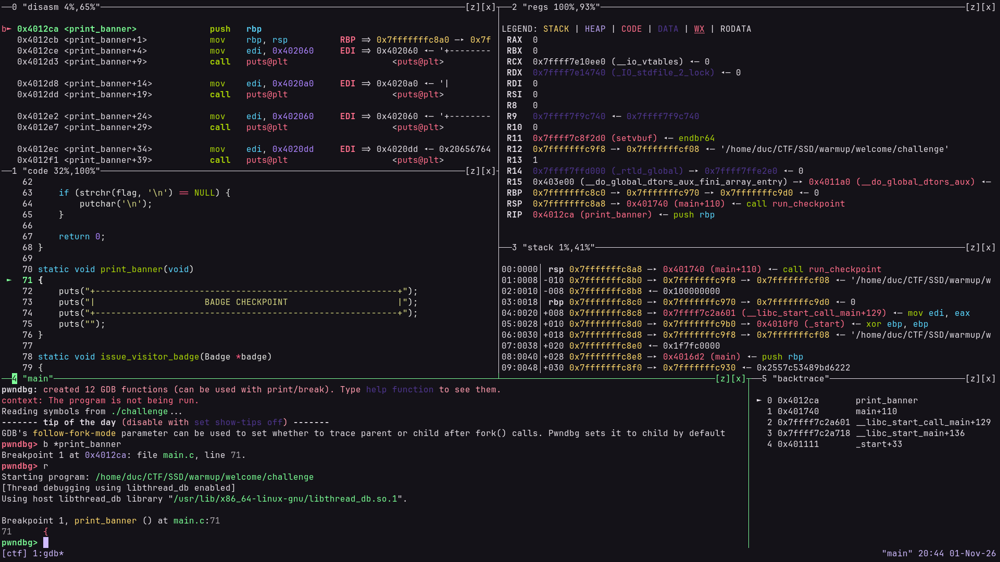
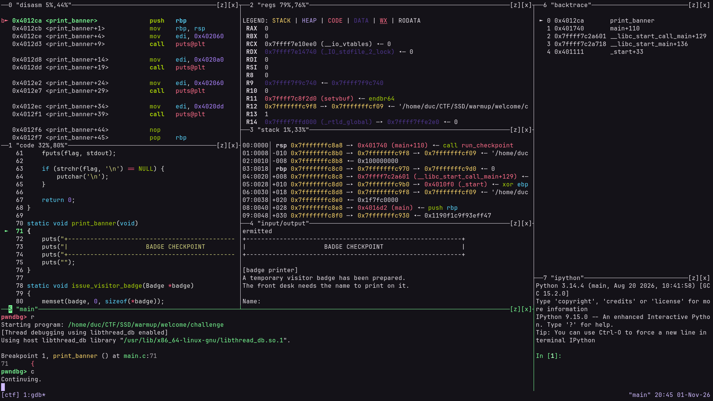

# tuimux

A customizable TUI+tmux setup for [pwndbg](https://github.com/pwndbg/pwndbg). It splits your tmux window into panes and streams each pwndbg context section into its own scrollable TUI viewer.



## Features

- Switch layouts without restarting GDB.
- Focus, zoom, scroll, wrap, copy, and search in each pane.
- Browse synchronized history across panes.
- Keep regex-matched lines (such as pwndbg's `►`) centered while stepping.
- Navigate panes without the tmux prefix.
- Create your own layout with a short Python function.

## Requirements

- [pwndbg](https://pwndbg.re/stable/setup) (`~/.gdbinit` or installer setup)
- [tmux](https://github.com/tmux/tmux)

## Installation

Clone the repository:

```sh
git clone https://github.com/duclm278/tuimux
```

Add this to `~/.gdbinit` after pwndbg:

```gdb
# Only needed for ~/.gdbinit setup
source /path/to/pwndbg/gdbinit.py

set context-clear-screen on
set follow-fork-mode parent

source /path/to/tuimux/gdbinit.py
tuimux layout simple_code -y
```

Replace `/path/to/...` with the paths on your system. History requires `context-clear-screen on`.

Start tmux, then run `gdb ./binary` or, if available, `pwndbg ./binary`. The configured layout opens automatically.

### Using pwntools

Set the terminal in your pwntools script:

```python
context.terminal = ["tmux", "new-window"]
```

## Usage

### Viewer keys

Focus a viewer pane, then use:

| Key | Action |
| --- | --- |
| `h` `j` `k` `l` / Arrows | Scroll 10 columns or rows |
| `H` `J` `K` `L` / Shift+Arrows | Scroll 20 columns or rows |
| `PgUp` `PgDn` | Scroll one page |
| `0` / `Home`, `$` / `End` | Go to the start / end of the line |
| `g` / `G` | Go to the top / bottom |
| `[` / `]` | Show the older / newer history frame |
| `{` / `}` | Show the oldest frame / return to live output |
| `/` / `?` | Search down / up |
| `n` / `N` | Go to the next / previous match |
| `Esc` | Cancel search or clear highlights |
| `w` | Toggle line wrapping |
| `f` | Pause or resume automatic centering |
| `m` | Toggle mouse capture |

Scroll with the mouse wheel or a two-finger swipe; hold Shift for horizontal scrolling. Drag to select and copy. Press `m` to use your terminal's normal selection instead.

### History and synchronized controls

Each pwndbg redraw is saved for the current session. Use `[` and `]` to move through frames, or `{` and `}` to jump to the oldest frame and back to live output.

History navigation and the `f`, `m`, and `w` toggles are synchronized across panes; scrolling and search stay local. New output returns to live by default. Set `follow_live=False` to stay in history.

### Search and automatic centering

Press `/` or `?` for an incremental Python regex search. An empty search repeats the previous one.

Some panes automatically keep a matching line centered. Built-in layouts use this for pwndbg's `►` marker. Press `f` to pause or resume it; pressing `ff` quickly re-centers the current line.

**Tip:** Increase `context-<section>-lines` to browse more output while follow keeps `►` centered. The provided layouts will suggest this automatically.

### tmux keys

These shortcuts work without the tmux prefix:

| Key | Action |
| --- | --- |
| `Alt+h/j/k/l` / `Alt+Arrows` | Move between panes |
| `Alt+z` | Zoom or restore the current pane |

By default, layouts also enables mouse support, pane titles, and top pane borders. Pass `--no-init-mux` to `tuimux layout` to manage your own tmux settings.

### GDB commands

| Command | Description |
| --- | --- |
| `tuimux layout` | Show the current and available layouts |
| `tuimux layout NAME` | Switch layouts |
| `tuimux layout NAME -y` | Switch layouts and apply their recommended options |
| `tuimux layout NAME -n` | Switch layouts without applying recommended options |
| `tuimux layout NAME --no-init-mux` | Switch layouts without changing tmux options |

`mux` is an alias for `tuimux`, and commands support tab completion. Without `-y` or `-n`, tuimux asks whether to apply the recommended options.

Suggested options per layout:

| Layout | `context-code-lines` | `context-stack-lines` | `context-disasm-lines` |
| --- | --- | --- | --- |
| `duo_*` | 14 | 8 | 10 |
| `simple` | 14 | 1024 | 10 |
| `splitmind` | 18 | 1024 | 10 |
| `*_code` | 1024 | 1024 | 1024 |

## Layouts

| Layout | Description |
| --- | --- |
| `duo_1` | GDB left, combined viewer right |
| `duo_2` | Mirror of `duo_1`: viewer left, GDB right |
| `simple` | A balanced layout with most important sections |
| `simple_code` | `simple` with a separate code pane |
| `splitmind` | [splitmind](https://github.com/jerdna-regeiz/splitmind)-style with I/O and IPython panes |
| `splitmind_code` | `splitmind` with a separate code pane |

`duo_1` / `duo_2`:

```txt
duo_1                        duo_2
┌────────────┬────────────┐  ┌────────────┬────────────┐
│ main (gdb) │ regs       │  │ regs       │ main (gdb) │
│            │ disasm     │  │ disasm     │            │
│            │ code       │  │ code       │            │
│            │ stack      │  │ stack      │            │
│            │ ...        │  │ ...        │            │
└────────────┴────────────┘  └────────────┴────────────┘
```

Both show `context-sections` in one scrollable viewer. Set `context-sections` before creating the layout to change them. Suitable if you want a big GDB pane.

`simple` / `simple_code`:

```txt
simple                                         simple_code
┌─────────────────────┬─────────────────────┐  ┌─────────────────────┬─────────────────────┐
│ disasm              │ regs                │  │ disasm              │ regs                │
│ ...                 │                     │  │                     │                     │
│                     ├─────────────────────┤  ├─────────────────────├─────────────────────┤
│                     │ stack               │  │ code                │ stack               │
│                     │                     │  │                     │                     │
├─────────────────────┴─────────┬───────────┤  ├─────────────────────┴─────────┬───────────┤
│ main (gdb)                    │ backtrace │  │ main (gdb)                    │ backtrace │
│                               │ ...       │  │                               │ ...       │
└───────────────────────────────┴───────────┘  └───────────────────────────────┴───────────┘
```

`splitmind` / `splitmind_code`:

```txt
splitmind                                      splitmind_code
┌───────────┬───────────────────┬───────────┐  ┌───────────┬───────────────────┬───────────┐
│ disasm    │ regs              │ backtrace │  │ disasm    │ regs              │ backtrace │
│ ...       ├───────────────────┤ ...       │  │           ├───────────────────┤ ...       │
│           │ stack             │           │  ├───────────┤ stack             │           │
│           ├───────────────────┤           │  │ code      ├───────────────────┤           │
│           │ input/output      ├───────────┤  │           │ input/output      ├───────────┤
├───────────┴───────────────────┤ ipython   │  ├───────────┴───────────────────┤ ipython   │
│ main (gdb)                    │           │  │ main (gdb)                    │           │
└───────────────────────────────┴───────────┘  └───────────────────────────────┴───────────┘
```



The splitmind input/output pane prints its terminal path. Run `tty /dev/pts/<num>` in GDB to route the program's I/O there.

## Creating a layout

A layout is a Python function that splits the main GDB pane. Add one to your GDB config after sourcing tuimux:

```python
source /path/to/tuimux/gdbinit.py
python
from tuimux import *
@layout(opts={
    "context-code-lines": 1024,
    "context-stack-lines": 1024,
    "context-disasm-lines": 1024,
})
def custom(ma):
    ba = view(ma, R, "25%", "backtrace", follow="►")
    di = view(ma, U, "80%", "disasm", follow="►")
    io = make(di, R, "55%", "input/output", cmd="tty; tail -f /dev/null")
    st = view(io, U, "75%", "stack")
    re = view(st, U, "60%", "regs").add("legend")
    ip = make(ba, D, "30%", "ipython", cmd="ipython3")
    co = view(di, D, "55%", "code", follow="►")
    ba.add("threads", banner="top")
end
tuimux layout custom -y
```

Helpers:

```python
L, D, U, R  # sides: left, down, up, right
@layout(opts=None)  # opts: suggested GDB options
make(base, side, size, name, cmd="cat -")  # plain pane
view(base, side, size, name, follow=None, follow_mode=None, follow_live=True, mouse=True, wrap=False, **options)
Area.add(*sections, **options)  # defaults: clearing=True, banner="none"
```

Use `view()` for pwndbg sections and `make()` for commands. `.add()` is chainable; unmapped sections stay in GDB. `**options` go to pwndbg's `contextoutput`.

- `size`: a tmux value such as `30` or `30%`.
- `follow_mode`: `buffer` searches all text; `line` finds the first matching line; `last` finds the last.
- `follow_live`: whether to return from [history](#history-and-synchronized-controls) when new output arrives.

Panes split from their `base`, so order matters. See [tuimux.py](tuimux.py) for examples.

## Troubleshooting

- **Nothing happens.** Run GDB inside tmux, load pwndbg first, and call `tuimux layout <name> -y`.
- **Mouse selection does not work normally.** Press `m` to disable mouse capture.
- **The view keeps jumping.** Press `f` to pause automatic centering.
- **The view returns to live output.** Set `follow_live=False` for that viewer.
- **History is empty.** Add `set context-clear-screen on` to your config.
- **The splitmind layout shows a controlling-terminal warning.** This warning is harmless and can be ignored.

## Acknowledgements

Inspired by [kittydbg](https://github.com/k4lizen/kittydbg), [pwnmux](https://github.com/joaogodinho/pwnmux), [splitmind](https://github.com/jerdna-regeiz/splitmind), and [hyperpwn](https://github.com/bet4it/hyperpwn).
